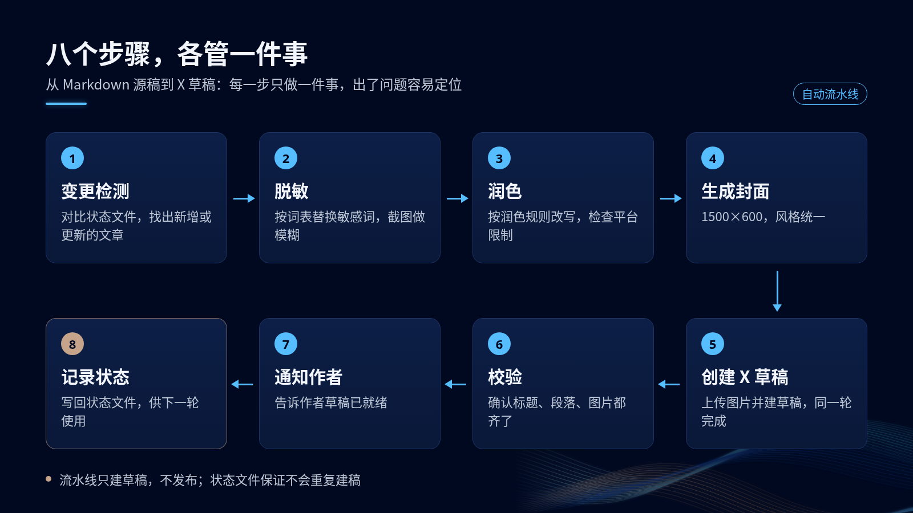
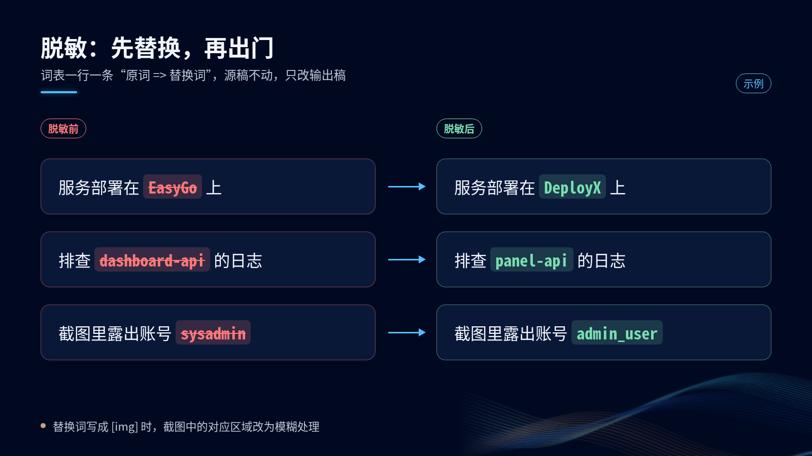
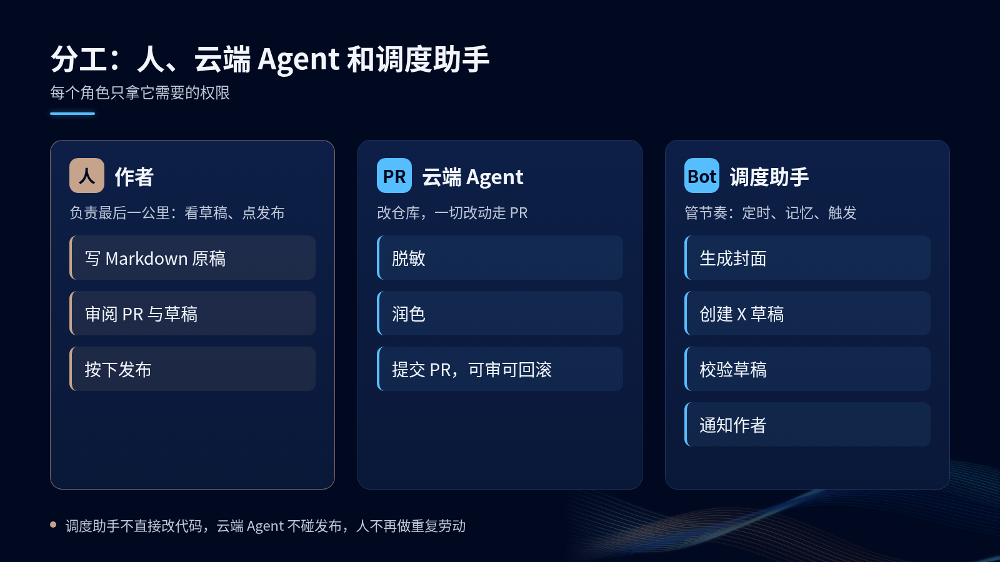
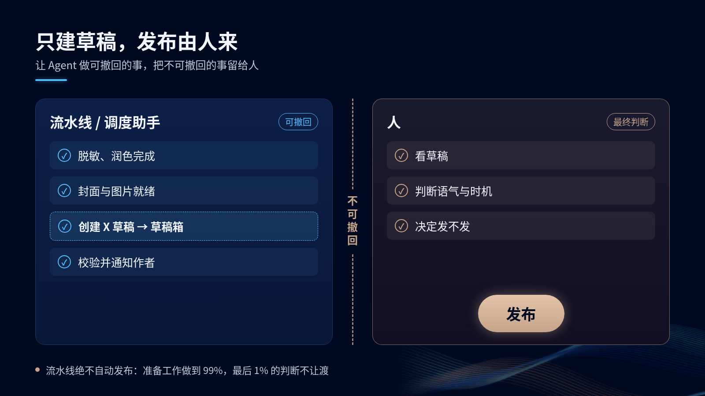

# 写完就有草稿：我把“文章 → X 草稿”做成了一条自动流水线

写技术文章最累的往往不是写，而是写完之后：检查有没有把内部信息带出去、按平台习惯改一遍措辞、做封面、复制粘贴到编辑器、再发现格式全乱了。每篇文章都要重来一遍，这种重复劳动正是该交给 Agent 的事。

于是我搭了一条流水线：我只管在仓库里写 Markdown，剩下的从脱敏、润色到生成 X Articles 草稿，全部自动完成。最后一步“发布”，永远留给人。这篇文章本身，就是这条流水线的第一篇测试稿。



## 源头：一个私有仓库，一种固定结构

所有原稿都放在一个私有 GitHub 仓库 deep-engineering 里。约定很简单，每篇文章一个目录，目录名带日期：

```text
deep-engineering/
├── articles/
│   └── YYYY-MM-DD-title/
│       ├── article.md
│       ├── pic/
│       └── cover.png
└── skills/
    ├── desensitize/   # config/sensitive-words.txt
    ├── polish/        # config/polish-rules.md
    └── cover-gen/     # config/style-prompt.md
```

articles 下是内容，skills 下是能力。每个 skill 把“规则”放在 config 里：脱敏词表、润色规则、封面风格提示词。想调整行为时改配置就行，不用动流程本身。这一点对团队很重要，写作者不需要懂流水线，只需要知道“规则写在哪”。

## 八个步骤，各管一件事

整条流水线拆成八步，每一步只做一件事，出了问题也容易定位。

第一步是变更检测。系统把仓库里的文章和一份状态文件做对比，找出新增或更新过的文章，没变的直接跳过。这样流水线可以放心地定时跑，不会重复生成。

第二步是脱敏，文字和图片都要处理，后面单独展开。

第三步是润色。原稿通常是写给同事看的，术语密、节奏快；X 上的读者需要更清晰的开头和更短的段落。润色规则写在 polish-rules.md 里，Agent 按规则改写，而不是自由发挥。

第四步是平台限制检查。X Articles 有不少隐性约束：代码块大约有一万个加权字符的上限，中日韩字符按 2 计；不支持嵌套列表；三级标题最好别用。超长的文章会被自动拆成多篇。

第五步生成 1500×600 的封面，风格由 style-prompt.md 统一控制，保证系列文章看起来像一家人。

第六步通过 X API 创建 Articles 草稿，认证走 OAuth 2.0 PKCE。这里有个容易踩的坑：上传的媒体 24 小时后过期，所以图片上传和草稿创建必须放在同一轮里完成。

第七步是校验，确认草稿的标题、段落和图片都齐了。第八步通知作者，并把这次处理结果写回状态文件，供下一轮变更检测使用。

## 脱敏：先替换，再出门

技术文章最容易出事的地方，是不经意间带出来的内部信息。比如我写部署经验时会顺手提到 EasyGo，排查问题时会贴出 dashboard-api 的日志，截图里还可能露出 sysadmin 这样的账号名。对自己人来说这些再平常不过，对外发布时就是风险。

所以脱敏是流水线里最早处理内容的一步。规则放在 sensitive-words.txt 里，格式是一行一条 `原词 => 替换词`。文字部分直接替换；如果替换词写成 [img]，就表示这个词出现在截图里时要做模糊处理，而不是简单地改字。



这个设计的关键在于：词表是集中维护的。新人不需要记住“哪些名字不能说”，只要词表在，流水线每次都会兜底。

## 分工：人、调度助手和云端 Agent

这条流水线里有三个角色，边界划得很清楚。

调度助手（Grok Bot）负责“什么时候做、做到哪了”：定时、记忆、触发、校验和通知都归它。它记得上次处理到哪篇文章，知道什么时候该叫醒下一步。

Cursor 云端 Agent 负责“改仓库”：对文章和配置的所有修改都以 PR 的形式提交，可以审查，也可以回滚。Agent 再聪明，改动也要留痕。

人负责最后一公里：看草稿、点发布。



这种分工的好处是，每个角色都只拿到它需要的权限。调度助手不直接改代码，云端 Agent 不碰发布，人不用再做重复劳动。

## 只建草稿，发布永远是人的事

我给流水线定了一条硬规则：它只能创建草稿，绝不自动发布。

原因很朴素。发出去的内容代表的是我本人，语气、时机、要不要发，都需要人来判断。自动化可以把准备工作做到 99%，最后那 1% 的判断不能让渡。这也是我在团队里培训编码 Agent 时反复强调的：让 Agent 做可撤回的事，把不可撤回的事留给人。



## 踩过的坑

第一个坑是仓库可见性。最早仓库是公开的，后来意识到原稿和真实敏感词表本身就是敏感信息，一旦公开，脱敏就失去了意义。现在仓库已改为私有，原文和词表都不进任何公开位置。

第二个坑是草稿管理。X 目前没有列出或删除草稿的 API，这意味着流水线一旦重复创建，就只能人工去清理。所以变更检测和状态文件必须可靠，宁可漏跑一次，也不要重复建稿。

第三个坑是长度。有一篇长文超过了平台限制，最终被拆成了 3 篇。拆分不能只按字数硬切，要按章节自然断开，并在每篇开头说明是系列的第几部分。

## 写在最后

这条流水线没有用到什么复杂技术，真正起作用的是三件事：规则集中放在配置里，每一步只做一件事，不可撤回的动作永远留给人。

如果你也在用 Agent 搭自己的内容工作流，不妨从“只建草稿”开始。先让机器把准备工作做好，再决定要不要把更多环节交出去。
